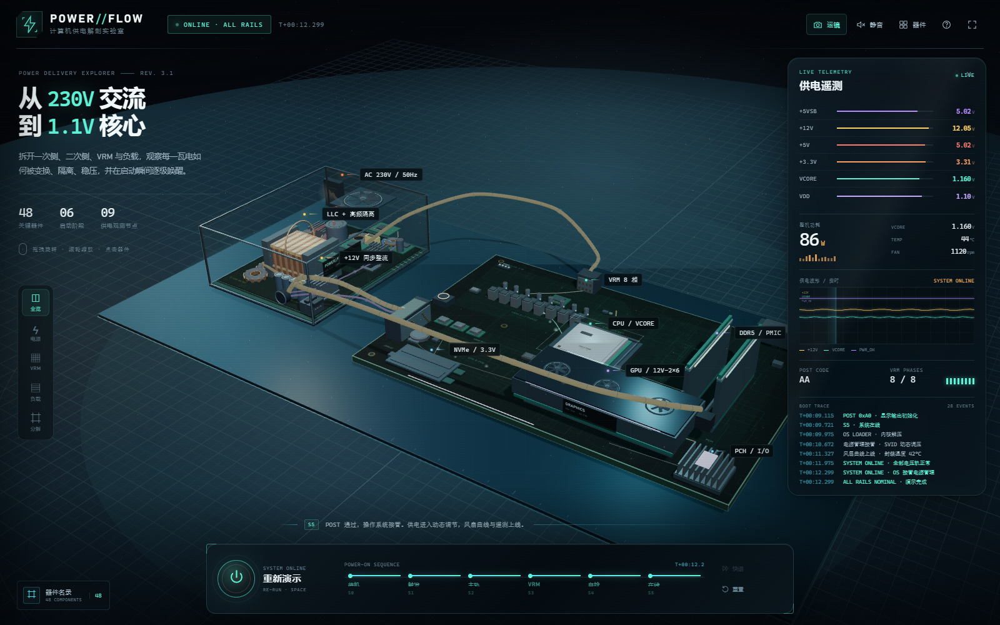

# POWER//FLOW · 计算机供电 3D 解剖实验室

一个可以直接打开、无需安装依赖的交互式 3D 网页：从墙插的 230V 交流电开始，逐级拆解 ATX 电源、主板供电、VRM、CPU / GPU / DDR5 负载，并用一段 6 阶段虚拟启动演示，观察电压轨、保护信号与能量流如何依次建立。



## 快速开始

直接双击 **`index.html`** 即可（推荐使用最新版 Chrome / Edge）。网页完全离线运行，不需要 Node.js、不需要构建、不会请求网络资源。

也可以通过任意静态服务器访问：

```bash
python -m http.server 8000
# 打开 http://127.0.0.1:8000/
```

> 请保留整个文件夹结构。`index.html` 依赖同目录下的 `styles.css`、`data.js`、`app.js` 与 `vendor/three-r128.min.js`。

## 操作方式

| 操作 | 效果 |
| --- | --- |
| 拖拽 / 单指拖动 | 旋转 3D 场景 |
| 滚轮 / 双指捏合 | 缩放 |
| 点击器件、场景标签或名录条目 | 打开器件原理说明与关键参数 |
| 点击底部电源按钮 / `Space` | 启动、重新演示或中止虚拟启动 |
| 时间轴节点 | 跳转到对应启动阶段 |
| `E` 或「分解」 | 爆炸分解视图，器件逐层脱离装配 |
| `R` | 回到待机，重置演示 |
| `L` | 打开 48 个器件的完整名录（可搜索） |
| `1` – `4` | 全览 / 电源 / VRM / 负载视角 |
| `H` | 操作指南 |
| `M` | 声音开关（继电器、风扇、电流底噪） |
| `F` | 全屏 |

在窄屏设备上，点击顶部 **STANDBY / ONLINE** 状态标签可以展开完整遥测面板，详情会自动变为底部抽屉。

## 页面内容

### 48 个关键器件，7 大供电层级

1. **市电输入与保护**：市电、IEC 输入口、保险丝、MOV、NTC + 继电器、EMI 滤波。
2. **PSU 一次侧**：整流桥、PFC 控制器 / MOSFET / 升压电感 / SiC 二极管、高压母线电容、LLC 控制器与半桥、谐振腔、高频变压器。
3. **PSU 二次侧与输出**：同步整流、输出滤波电感、固态电容组、光耦反馈、保护监控 IC、5VSB 辅助电源、PSU 风扇。
4. **主板供电与接口**：ATX 24-pin、EPS 8-pin、12V-2×6、SATA 供电、DC-DC Buck、LDO。
5. **VRM 电压调节**：多相控制器、DrMOS、合金电感、固态电容、电压/电流/温度采样。
6. **计算与负载**：CPU 插座与核心、DDR5 与板载 PMIC、GPU 与显存、GPU VRM、PCH、NVMe。
7. **平台辅助电路**：BIOS/SPI、CMOS 电池、时钟、风扇/ARGB、USB/网络/音频供电、电源按钮待机逻辑、POST 诊断。

每个器件都包含中文功能说明、英文名、所属区域、供电轨、参与启动阶段、4 组关键参数和相关器件跳转。

### 六阶段虚拟启动

| 阶段 | 发生什么 |
| --- | --- |
| `S0 待机` | 市电接入，5VSB 常开；主轨与计算负载关闭 |
| `S1 触发` | PS_ON# 拉低，NTC 旁路、PFC 母线升压、LLC 软启动 |
| `S2 主轨` | +12V / +5V / +3.3V 建立，PWR_OK 置高 |
| `S3 VRM` | 8 相 DrMOS 依次启机，VCORE / VSOC / VDD 建立，CPU 复位释放 |
| `S4 自检` | DDR5 训练、PCIe 5.0 链路、NVMe 枚举、POST |
| `S5 在线` | 操作系统接管，风扇曲线、动态调压、遥测上线 |

演示过程中可观察：

- 电压轨实时数值、整机功耗、VCORE、温度与风扇转速；
- `+12V / VCORE / PWR_OK` 三路示波器波形；
- POST 码、8 相供电指示灯与逐相点亮的 DrMOS；
- 线缆和 PCB 上的流动能量粒子；
- PSU 风扇 / GPU 风扇启动、DIMM 与 GPU 的 RGB 灯效；
- 自动运镜（拖拽场景会自动切换为自由视角）。

## 文件结构

```
powerflow3d/
├── index.html                 页面骨架与 UI
├── styles.css                 全部视觉样式与响应式布局
├── data.js                    48 个器件、7 类、6 阶段的结构化数据
├── app.js                     Three.js 场景、交互、启动时序与遥测
├── vendor/
│   └── three-r128.min.js      Three.js r128（MIT，离线内置）
├── preview.png                预览图
├── README.md
└── THREE-LICENSE.txt
```

## 自定义

- **改器件说明**：编辑 `data.js` 中的 `components` 数组。字段包括 `name`、`en`、`cat`、`rail`、`zone`、`role`、`detail`、`specs`、`related` 与 `stage`。
- **改启动阶段**：编辑 `data.js` 的 `stages` 与 `app.js` 的 `STAGE_EVENTS`。阶段时长以秒为单位。
- **改颜色**：在 `styles.css` 的 `:root` 中调整 AC / +12V / +5VSB / VCORE 等颜色；3D 线缆颜色位于 `app.js` 的 `addCable()` / `buildPowerNetwork()`。
- **改默认视角**：编辑 `app.js` 中的 `cam` 初始值与 `views` 预设。

## 技术说明

- 渲染：Three.js r128，WebGL 1 兼容路径，PBR 材质、软阴影、PMREM 环境反射、加色发光粒子。
- 3D 结构由基础几何体组合生成；PCB 走线、丝印和焊盘由 Canvas 程序化绘制，没有外部贴图。
- 动态效果与 UI 使用原生 JavaScript / CSS，无框架、无构建。
- 音频使用 Web Audio API 实时合成，默认关闭，需用户手动开启。
- 所有数值为现代桌面平台的**原理性典型量级**，器件比例和位置经过视觉化处理，不对应任何具体品牌或型号；不可作为电源维修或安规依据。
- **安全提示**：真实 ATX 电源内部存在 400V 级高压母线与大容量储能电容，断电后仍可能带电。请勿在未经过专业放电与安全培训的情况下拆解电源。

## 浏览器

建议 Chrome / Edge 100+、Firefox 100+、Safari 16+。需要启用 WebGL；如果设备性能较弱，可降低窗口尺寸或关闭其他 GPU 程序。`backdrop-filter`、`color-mix` 等视觉增强在较旧浏览器中会优雅降级。

## 许可

场景代码、数据文案与视觉设计可自由用于学习、教学与演示。Three.js 以 MIT 许可随包提供，版权归 Three.js Authors，详见 `THREE-LICENSE.txt`。
